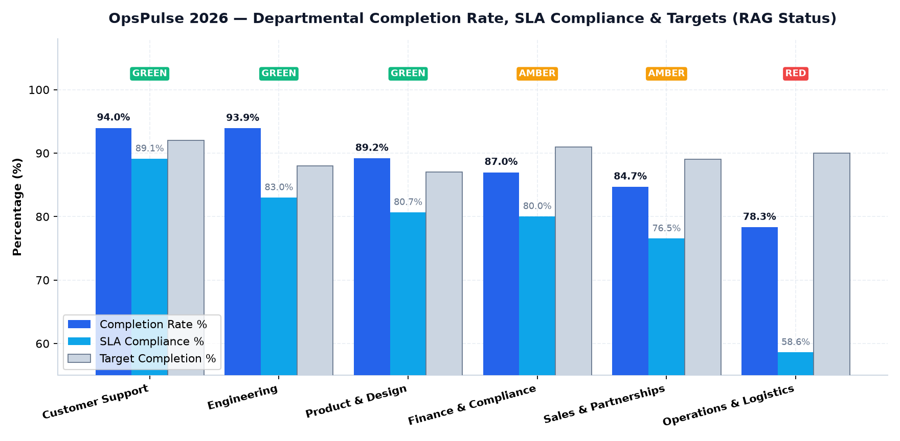
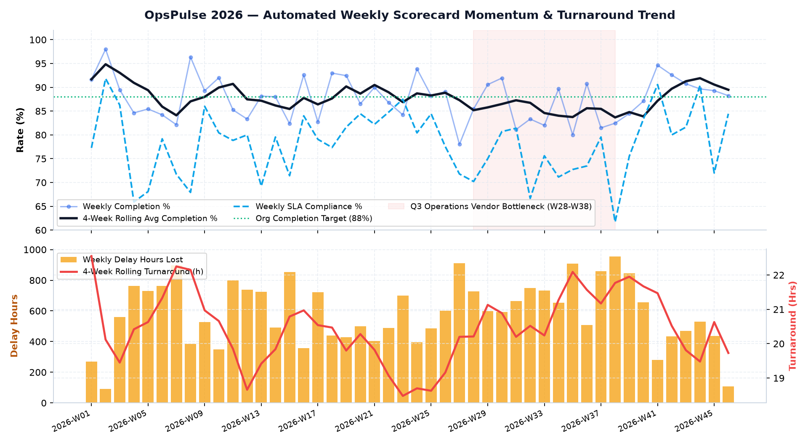
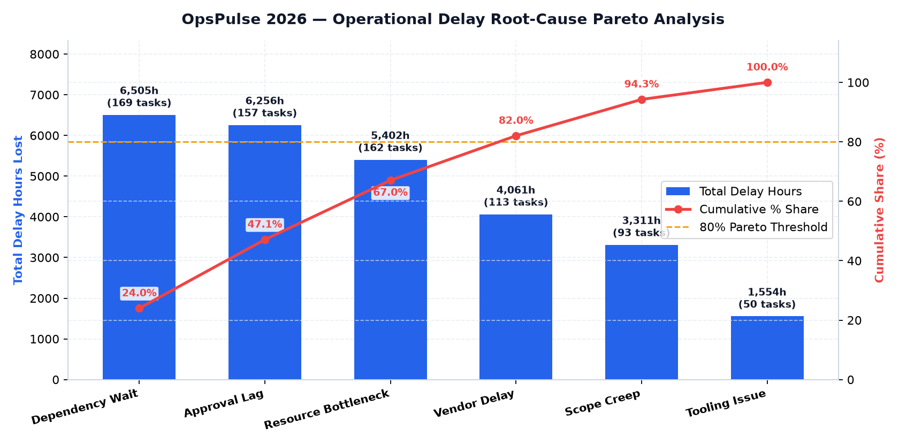
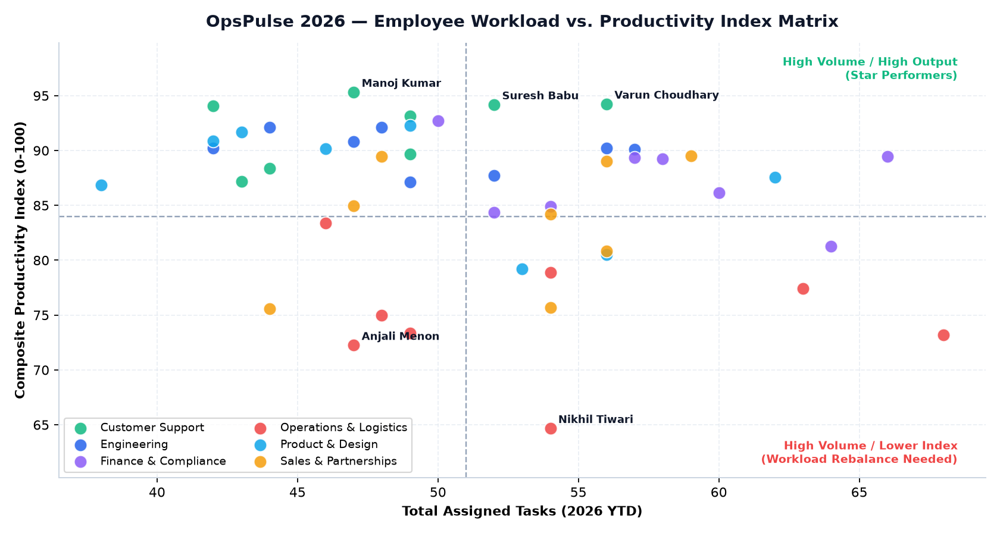
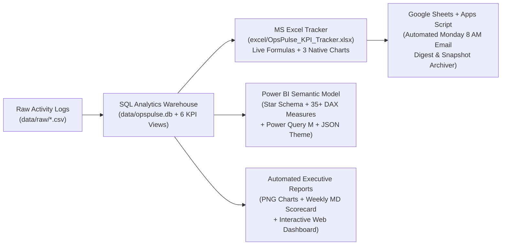

# OpsPulse — Employee Performance & Departmental KPI Tracker

[](#architecture)
[](#quickstart)
[](./LICENSE)

**OpsPulse** is an end-to-end centralized employee performance and departmental KPI tracking system built across **SQL, MS Excel, Google Sheets (Apps Script), and Power BI**. It monitors **task completion rates, turnaround times, SLA compliance, composite productivity indices, operational delays, and overdue milestones** across 6 enterprise departments and 48 employees over 46 ISO weeks (2026 YTD), automatically generating weekly performance scorecards and executive summary dashboards for leadership.

---

## Executive Snapshot (2026 YTD)

| Executive KPI | 2026 YTD Actual | Operational Context |
| :--- | :---: | :--- |
| **Total Tasks Monitored** | **2,474** | 6 departments · 48 employees · 36 milestones (W01–W46) |
| **Overall Task Completion Rate** | **87.6%** | 2,168 completed · 214 overdue · 88 blocked |
| **On-Time Delivery Rate** | **82.2%** | Completed on or before planned due date |
| **SLA Compliance Rate** | **78.3%** | Completed within priority-adjusted SLA hours |
| **Average Turnaround Time** | **20.4 hrs** | Weighted mean across all completed tasks |
| **Total Operational Delay Lost** | **27,088.7 hrs** | #1 root cause: **Dependency Wait** (24.0% share) |
| **Milestone Escalations** | **11** | Overdue & At-Risk milestones flagged for leadership |

---

## Visual Analytics Preview

### 1. Departmental KPI Scorecard vs. Targets (RAG Status)


### 2. Automated Weekly Scorecard Momentum & Turnaround Trend


### 3. Operational Delay Root-Cause Pareto (80/20 Bottleneck Diagnostics)


### 4. Employee Workload vs. Composite Productivity Index Matrix


---

## Architecture



---

## Key Business Insights Discovered

1. **Primary Operational Bottleneck (`Operations & Logistics` — Red):** Trailing its 90% completion target by **-11.7%** (78.3% actual, 58.6% SLA compliance) with **8,159.4 lost delay hours**, driven by a Q3 (W28–W38) carrier/vendor SLA disruption and resource bottlenecks.
2. **Organizational Benchmark (`Customer Support` & `Engineering` — Green):** Customer Support leads completion velocity at **94.0%** (89.1% SLA compliance, 8.7h avg turnaround), while Engineering outperforms its target by **+5.9%** (93.9% completion).
3. **Delay Root-Cause Pareto:** **Dependency Wait** (24.0%) and **Approval Lag** (23.1%) together account for **47.1%** of all delay hours, with **Resource Bottlenecks** (19.9%) and **Vendor Delays** (15.0%) bringing the top 4 drivers to **82.0%**.
4. **Milestone Escalation Priorities:** **11 milestones** (8 Critical, 3 High) are Overdue or At Risk — led by *Warehouse Barcode Automation* (`MS-009`, 25 open delayed tasks) and *Q3 Carrier Bottleneck Recovery* (`MS-010`, 21 open delayed tasks).

---

## Repository Structure

```text
opspulse-kpi-tracker/
├── data/
│   ├── raw/                             # Normalized 2026 source CSVs (departments, employees, milestones, tasks)
│   ├── processed/                       # SQL-exported KPI summary tables & weekly scorecards
│   └── opspulse.db                      # Populated SQLite analytical warehouse
├── sql/
│   ├── 01_schema.sql                    # Relational schema with PK/FK/CHECK constraints & indexes
│   ├── 02_kpi_views.sql                 # 6 analytical KPI views (window functions, WoW LAG, 4W rolling, Pareto)
│   └── 03_executive_queries.sql         # 10 executive ad-hoc SQL queries for leadership reviews
├── excel/
│   └── OpsPulse_KPI_Tracker.xlsx        # 7-tab live-formula Excel/Sheets workbook + RAG formatting + 3 charts
├── google_sheets/
│   ├── OpsPulse_AppsScript.gs           # Apps Script automation (custom menu, SLA alerts, Monday email digest)
│   └── GOOGLE_SHEETS_SETUP.md           # Setup walkthrough & native Google Sheets QUERY() recipes
├── powerbi/
│   ├── dax/kpi_measures.dax             # 35+ production DAX measures (SLA, WoW, Rolling 4W, Pareto, Productivity Index)
│   ├── power_query/transform_queries.m  # Power Query (M) ETL transformations & dynamic DimDate table
│   ├── OpsPulse_Theme.json              # Executive Power BI visual theme JSON
│   ├── data_model_schema.md             # Star-schema ER diagram & 4-page Power BI wireframe spec
│   └── POWERBI_BUILD_GUIDE.md           # Step-by-step Power BI Desktop assembly guide
├── dashboard/
│   ├── index.html                       # Interactive 4-tab Executive Dashboard (live Department/Quarter/Priority slicers)
│   └── data.js                          # SQL-exported JSON dataset powering the web dashboard
├── reports/
│   ├── weekly_executive_scorecard.md    # Auto-generated weekly leadership scorecard report
│   └── figures/                         # High-resolution analytical PNG visuals
└── scripts/
    ├── generate_dataset.py              # Deterministic 2026 operational dataset generator
    ├── build_warehouse.py               # SQLite ETL builder + automated data quality checks
    ├── build_excel_tracker.py           # Formula-driven openpyxl workbook generator
    ├── generate_charts_and_reports.py   # Matplotlib visuals, MD scorecard & dashboard feed builder
    └── run_pipeline.py                  # Single-command end-to-end orchestrator
```

---

## Tool-by-Tool Highlights

### 1. SQL Analytics Layer (`sql/`)
- Enforces referential integrity (`PRAGMA foreign_keys = ON`) across `departments`, `employees`, `milestones`, and `tasks`.
- Uses CTEs and analytical window functions (`DENSE_RANK()`, `LAG()`, `ROWS BETWEEN 3 PRECEDING AND CURRENT ROW`, running cumulative Pareto sums) across 6 production views:
  - `vw_task_metrics` · `vw_employee_performance` · `vw_department_kpi_summary` · `vw_weekly_scorecard` · `vw_operational_delays` · `vw_overdue_milestones`
- Composite **Productivity Index (0–100)**:
  $$\text{Productivity Index} = 0.35(\text{Completion \%}) + 0.30(\text{SLA Compliance \%}) + 0.20(\text{Quality} \times 20) + 0.15(100 - \text{Rework \%})$$

### 2. MS Excel Centralized Tracker (`excel/OpsPulse_KPI_Tracker.xlsx`)
- **7 interconnected worksheets:** `Executive_Dashboard`, `Weekly_Scorecard`, `Employee_Leaderboard`, `Overdue_Milestones`, `Task_Log`, `Departments_Ref`, `Employees_Ref`.
- Powered exclusively by **live dynamic formulas** (`SUMIFS`, `COUNTIFS`, `AVERAGEIFS`, `IFERROR`, `RANK`, `IF`) with automated Green/Amber/Red conditional formatting and 3 embedded native Excel charts.

### 3. Google Sheets Automation (`google_sheets/`)
- Upload `excel/OpsPulse_KPI_Tracker.xlsx` to Google Sheets and attach [`OpsPulse_AppsScript.gs`](./google_sheets/OpsPulse_AppsScript.gs).
- Adds a custom **`OpsPulse KPI`** menu with automated SLA breach highlighting, immutable weekly snapshot archiving, and scheduled Monday 8:00 AM HTML executive email digests.

### 4. Power BI Semantic Model & Interactive Executive Dashboard (`powerbi/` & `dashboard/`)
- Complete Star Schema (`FactTasks` + `DimDepartments`, `DimEmployees`, `DimMilestones`, `DimDate`), 35+ DAX measures, Power Query M ETL scripts, and custom corporate JSON theme.
- Open [`dashboard/index.html`](./dashboard/index.html) directly in any browser for a live, interactive replica of the 4-page Power BI executive dashboard with real-time Department, Quarter, and Priority slicers.

---

## Quickstart

```bash
# 1. Clone the repository
git clone https://github.com/Madhesh0067/opspulse-kpi-tracker.git
cd opspulse-kpi-tracker

# 2. Install Python dependencies
pip install -r requirements.txt

# 3. Run the full end-to-end pipeline (Dataset -> SQL Warehouse -> Excel -> Charts & Dashboard)
python scripts/run_pipeline.py
```

Open **`excel/OpsPulse_KPI_Tracker.xlsx`** in Microsoft Excel / Google Sheets, inspect **`reports/weekly_executive_scorecard.md`**, or launch **`dashboard/index.html`** in your browser.

---

## Author

**Madhesh Srinivasan**  
B.Tech — Artificial Intelligence & Data Science  
[GitHub](https://github.com/Madhesh0067) · [LinkedIn](https://linkedin.com/in/madhesh-srinivasan-497132261) · `madheshrs006@gmail.com`
