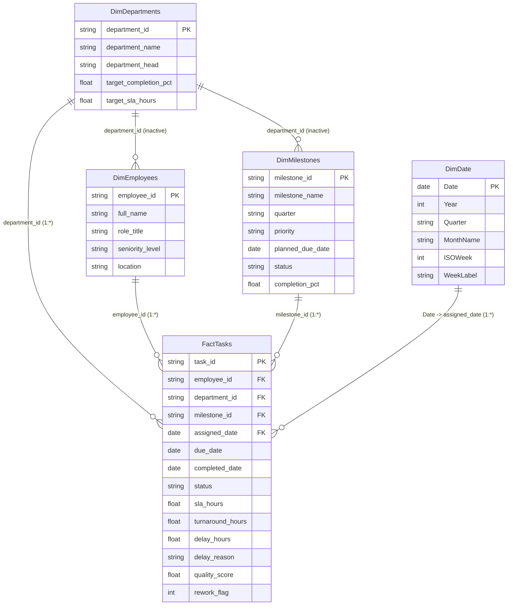

# Power BI Star Schema & Report Blueprint

## 1. Semantic Data Model (Star Schema)

> **Modeling Best Practice:** Keep single-directional (`1 → *`) filters from all Dimension tables into `FactTasks`. Keep `DimDepartments → DimEmployees` and `DimDepartments → DimMilestones` inactive to avoid ambiguous filter paths, using `USERELATIONSHIP()` only when cross-filtering dimension-only visuals.

---

## 2. Four-Page Executive Report Specification

### Page 1: Executive Command Center
- **Top KPI Cards (6):** `Total Tasks`, `Completion Rate %`, `SLA Compliance %`, `Avg Turnaround Hours`, `Total Delay Hours`, `Overdue Milestones`
- **Combo Chart:** Weekly `Completion Rate %` (columns) + `Rolling 4-Week Completion Rate %` (trend line) across `DimDate[WeekLabel]`
- **Clustered Bar Chart:** `Completion Rate %` vs `Target Completion Rate %` by `DimDepartments[department_name]` with conditional `Executive RAG Color`
- **Pareto Chart:** `Total Delay Hours` (columns) + `Delay Pareto Cumulative %` (line) by `FactTasks[delay_reason]`
- **Global Slicers:** Quarter, Department, Priority

### Page 2: Departmental KPI & Bottleneck Matrix
- **Matrix Visual:** Department × Delay Reason showing `Total Delay Hours` and `Delayed Task Count` with heat-map background scale
- **Scatter Plot:** `Avg Turnaround Hours` (X) vs `SLA Compliance %` (Y), bubble size = `Total Tasks`, legend = `Department`
- **Waterfall Chart:** Quarter-over-quarter change in `Total Delay Hours`

### Page 3: Employee Productivity & Workload Leaderboard
- **Ranked Table:** `Employee Org Rank`, `full_name`, `department_name`, `Completed Tasks`, `Completion Rate %`, `SLA Compliance %`, `Avg Quality Score`, `Rework Rate %`, `Productivity Index (0-100)`, `Performance Tier Label`
- **Quadrant Scatter:** `Total Tasks` (workload volume) vs `Productivity Index (0-100)` to identify high-output stars vs. overloaded employees

### Page 4: Overdue Milestones & Escalation Tracker
- **Escalation Table:** Filtered to `DimMilestones[status] IN {"Overdue", "At Risk"}` displaying Owner, Department, Priority, Planned Due Date, `% Complete`, Linked Open Delayed Tasks, and Blocker Summary.
- **Drillthrough:** Right-click any milestone to drill into its blocking `FactTasks`.
